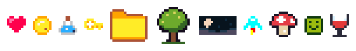

# Examples



| Sheet | Palette | Sprites | Shows |
| --- | --- | --- | --- |
| [`pico8.txt`](pico8.txt) | PICO-8 (default) | heart, coin, potion, key | the default palette, several sprites per sheet |
| [`icon.txt`](icon.txt) | PICO-8 (default) | folder | `ico`: a Windows `.ico` with sizes 16 to 256 |
| [`db16.txt`](db16.txt) | bundled `db16` | tree | a 16x16 sprite in a bundled palette |
| [`nyx8.txt`](nyx8.txt) | bundled `nyx8` | night | a wide (non-square) sprite |
| [`zx-spectrum.txt`](zx-spectrum.txt) | bundled `zx-spectrum` | rocket | a hardware palette |
| [`edg32.txt`](edg32.txt) | bundled `edg32` | mushroom | keys past `f` (`j`, `q`) in a 32-colour palette |
| [`gameboy.txt`](gameboy.txt) | bundled `gameboy` | smiley | a 4-colour palette |
| [`glass.txt`](glass.txt) | file [`glass-palette.txt`](glass-palette.txt) | glass | your own palette file, letter keys and `#RRGGBBAA` transparency |

Render them all with the `examples` target, which writes into
`build\vs2026\examples`:

```bat
cmake --build --preset release --target examples
```

The target picks each sheet's palette from its file name: `db16.txt` uses the
bundled `db16` palette, `glass.txt` uses `glass-palette.txt` next to it, and
anything else uses PICO-8. Follow the same naming to add an example.

Or run one by hand, e.g. `pixelart -p db16 -o out examples\db16.txt`.
